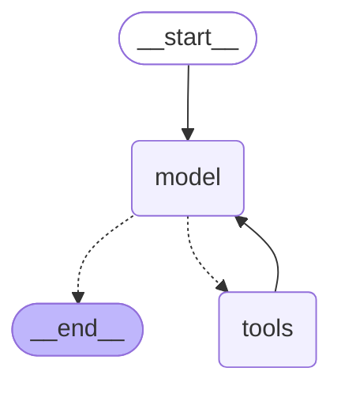
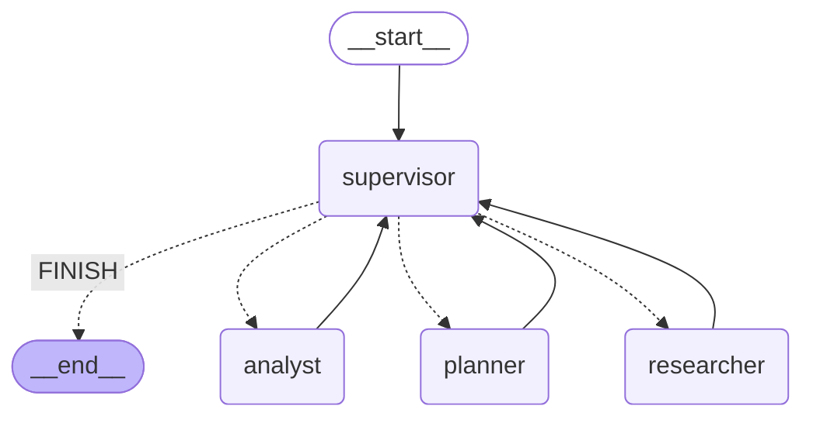

# llm-client

Proyecto integrador del curso de AI Engineering. Cada unidad suma una parte sobre la anterior:

- **Unidad 1 — Cliente asíncrono de LLMs** (`llm_client/`, `main.py`): interfaz común para OpenAI, Anthropic y Gemini, con respuestas normales y en streaming, validación de la configuración con Pydantic y errores controlados.
- **Unidad 2 — Pipeline de procesamiento validado** (`pipeline/`, `run_pipeline.py`): pipeline con LangChain (LCEL) que extrae información técnica de un texto (un log de error o una descripción de arquitectura) y devuelve un objeto validado con Pydantic.
- **Unidad 3 — Sistema RAG local** (`rag/`, `run_ingest.py`, `run_rag.py`, `data/`): responde preguntas sobre los documentos de una agencia de viajes ficticia usando solo esos documentos, guardados en una base vectorial local (ChromaDB). Si la respuesta no está en los documentos, responde "No lo sé".
- **Unidad 4 — Sistema RAG escalable en la nube** (`cloud_rag/`, `setup_pinecone.py`, `ingest_pinecone.py`, `evaluate.py`, `benchmark/`, `tests/`): los mismos documentos en un índice serverless de Pinecone, con ingesta incremental, búsqueda híbrida (BM25 + vectorial con `EnsembleRetriever`) y evaluación con Recall@5 y Precision@5.
- **Unidad 5 — Agente ReAct con LangGraph** (`agent/`, `run_agent.py`, `traces/`): agente que consulta reservas simuladas y busca en los manuales con el RAG de la unidad 4, con reintento, pedido de aclaración, `recursion_limit` y memoria por conversación en SQLite.

La versión exacta de cada entrega: unidad 1 en el tag [`unidad-1`](https://github.com/luurdz/llm-client/tree/unidad-1), unidad 2 en la rama [`entrega-2`](https://github.com/luurdz/llm-client/tree/entrega-2), unidad 3 en la rama [`entrega-3`](https://github.com/luurdz/llm-client/tree/entrega-3) y unidad 4 en el tag [`unidad-4`](https://github.com/luurdz/llm-client/tree/unidad-4).

## Requisitos

- Python 3.12 o superior (probado con Python 3.14)
- Una API key del proveedor que se quiera usar. Gemini tiene una capa gratuita: https://aistudio.google.com/apikey

## Instalación

Crear y activar un entorno virtual:

```bash
python -m venv .venv
```

Windows (PowerShell):

```bash
.venv\Scripts\Activate.ps1
```

macOS / Linux:

```bash
source .venv/bin/activate
```

Instalar las dependencias:

```bash
pip install -r requirements.txt
```

## Configuración

Todas las unidades usan el mismo `.env`. Copiar `.env.example` a `.env` y completar la API key del proveedor que se va a usar.

Windows (PowerShell):

```bash
Copy-Item .env.example .env
```

macOS / Linux:

```bash
cp .env.example .env
```

| Variable | Descripción |
|---|---|
| `LLM_PROVIDER` | Proveedor a usar: `openai`, `anthropic` o `gemini`. Por defecto: `gemini` |
| `LLM_MODEL` | Modelo del proveedor elegido, por ejemplo `gemini-flash-lite-latest`, `gpt-4o-mini` o `claude-opus-5-5` |
| `LLM_FALLBACK_MODEL` | Opcional (unidad 2). Modelo del mismo proveedor que se usa cuando falla el principal, por ejemplo `gemini-3.5-flash-lite` |
| `EMBEDDING_MODEL` | Unidad 3. Modelo de embeddings del proveedor elegido: `gemini-embedding-001` (Gemini) o `text-embedding-3-small` (OpenAI). Anthropic no tiene modelo de embeddings |
| `GOOGLE_API_KEY` | API key de Gemini |
| `OPENAI_API_KEY` | API key de OpenAI |
| `ANTHROPIC_API_KEY` | API key de Anthropic |
| `PINECONE_API_KEY` | Unidad 4. API key de Pinecone (el plan gratuito Starter alcanza): https://app.pinecone.io |
| `INDEX_NAME` | Unidad 4. Nombre del índice de Pinecone, por ejemplo `rumbo-sur` |
| `PINECONE_NAMESPACE` | Unidad 4. Namespace donde se guardan los vectores, por ejemplo `dev` |

Solo es obligatoria la key del proveedor elegido. El archivo `.env` está en el `.gitignore`.

Para cambiar de proveedor, alcanza con cambiar `LLM_PROVIDER` y `LLM_MODEL` en el `.env`. No hace falta tocar el código.

## Unidad 1 — Cliente asíncrono de LLMs

```bash
python main.py
```

El script le pregunta "¿Qué es la entropía?" al proveedor configurado y corre tres pruebas:

1. **Modo normal**: espera la respuesta completa y la muestra.
2. **Modo streaming**: muestra la respuesta de a pedazos, a medida que llega.
3. **Prueba de resiliencia**: hace la misma pregunta con una API key inválida y muestra el error que devuelve el cliente. El programa sigue funcionando después del error.

Si la configuración está mal (proveedor no soportado, falta el modelo o la API key está vacía), el script muestra un error de configuración y termina.

### Diseño

- **Interfaz común**: todos los clientes heredan de `BaseLLMClient` e implementan `generate()` y `generate_stream()`.
- **Factory**: `AsyncLLMManager` elige la clase del cliente con un diccionario (`CLIENTS`) según `config.provider`. Para agregar un proveedor hay que crear su cliente y sumar una entrada al diccionario.
- **Validación**: `LLMConfig` valida el proveedor, el modelo, la temperatura (de 0 a 2), `max_tokens` (mayor que 0), el timeout y la API key, que se guarda como `SecretStr` para que no aparezca en los logs. Todos los clientes reciben este mismo objeto de configuración.
- **Asincronía**: todas las llamadas usan la versión asíncrona de cada SDK (`AsyncOpenAI`, `AsyncAnthropic` y `client.aio` en Gemini).
- **Streaming**: `generate_stream()` es un generador asíncrono que devuelve objetos `StreamChunk`. Cada chunk tiene `content` o `error`, así un error en el medio del stream se distingue del texto.
- **Manejo de errores**: cada cliente traduce los errores de su propio SDK (rate limit, conexión, errores del servidor, pedidos inválidos) a un `ModelResponse` o `StreamChunk` con el campo `error` completo. Todas las llamadas tienen un timeout (`asyncio.timeout`, configurable en `LLMConfig`). Los reintentos los hacen los SDKs: OpenAI y Anthropic reintentan dos veces por defecto, y el cliente de Gemini está configurado con 3 intentos.
- **Diferencias entre proveedores**: Gemini y Anthropic reciben el mensaje de sistema como un parámetro aparte, y Gemini usa el rol `model` en lugar de `assistant`. Cada cliente convierte los mensajes al formato de su proveedor.

## Unidad 2 — Pipeline de procesamiento validado

```bash
python run_pipeline.py
```

El script tiene dos partes y muestra los logs de cada paso:

1. **Single text (`ainvoke`)**: procesa un texto con `process_text()`.
2. **Batch (`abatch`)**: procesa los tres textos de ejemplo a la vez con `process_texts()`:
   - **normal**: un log de error con varias tecnologías.
   - **ambiguous**: un texto que habla de "la base de datos" y "el caché" sin decir cuáles (prueba de estrés).
   - **non_technical**: un texto sin información técnica.

### Ejemplo de salida

Para el caso `normal`:

```json
{
  "tecnologias": ["FastAPI", "PostgreSQL", "Kafka", "Redis"],
  "nivel_de_criticidad": "alta",
  "resumen_tecnico": "El servicio de pedidos en FastAPI tiene timeouts al llamar a payment-service porque el pool de conexiones de PostgreSQL está agotado y la tasa de aciertos del caché en Redis bajó al 5%."
}
```

Para los casos `ambiguous` y `non_technical`, el modelo devuelve una lista de tecnologías vacía, el validador la rechaza y la cadena reintenta tres veces. En el lote, el error ocupa el lugar de ese texto y los demás resultados no se pierden:

```
WARNING pipeline.chain: The response was invalid. Retry
WARNING pipeline.chain: The response was invalid. Retry
WARNING pipeline.chain: The response was invalid. Retry
--- ambiguous ---
Extraction failed: Failed to parse TechnicalEntities from completion {"technologies": [], ...
```

### Uso desde código

```python
from pipeline.chain import process_text, process_texts

entities = await process_text("SQL Server está caído")
print(entities.model_dump_json(by_alias=True, indent=2))

results = await process_texts(["SQL Server está caído", "Redis responde lento"])
```

- `process_text()` devuelve un `TechnicalEntities`, o lanza el error si la extracción falla.
- `process_texts()` devuelve una lista en el mismo orden que los textos. Cada elemento es un `TechnicalEntities` o el error de ese texto.
- Con `by_alias=True`, las claves del JSON salen en castellano.

### Diseño

- **Esquema** (`pipeline/schemas.py`): `TechnicalEntities` con `technologies`, `criticality_level` (enum `baja` / `media` / `alta`) y `technical_summary`. Los nombres del código están en inglés y las claves del JSON en castellano, con `serialization_alias`. Las descripciones de los campos y el docstring de la clase forman parte del esquema que recibe el modelo.
- **Prompt** (`pipeline/prompts.py`): `ChatPromptTemplate` con un mensaje de sistema y la variable `{text}`.
- **Modelo** (`llm_client/langchain_models.py`): `build_chat_model()` crea `ChatOpenAI`, `ChatAnthropic` o `ChatGoogleGenerativeAI` según `LLMConfig`, reutilizando la configuración y el `.env` de la unidad 1. El pipeline usa temperatura 0 para que el mismo texto dé siempre el mismo resultado.
- **Cadena** (`pipeline/chain.py`): `prompt | model.with_structured_output(TechnicalEntities, include_raw=True) | check_output`, con `.with_retry()` de hasta 3 intentos.
- **Resiliencia**:
  - Los errores de validación (`OutputParserException`, `ValidationError`) se reintentan.
  - `check_output()` revisa el `finish_reason` de la respuesta. Si el modelo cortó la respuesta por llegar a `max_tokens`, lanza `IncompleteOutputError` sin reintentar, porque con el mismo límite se cortaría de nuevo.
  - Si está configurado `LLM_FALLBACK_MODEL`, la cadena usa `.with_fallbacks()`: cuando el modelo principal falla por un error del proveedor (servidor caído, rate limit, timeout o conexión), repite el pedido con el modelo alternativo. Los errores de validación no pasan al modelo alternativo.
- **Lote**: `process_texts()` usa `.abatch()` con `max_concurrency=5`, para no superar el rate limit del proveedor, y `return_exceptions=True`, para que un texto con error no corte el lote.
- **Logs**: `logging` muestra el inicio de cada procesamiento, el modelo alternativo configurado, cada respuesta inválida antes de un reintento, las respuestas cortadas y las validaciones correctas.

### Qué agregué además de la consigna

- `process_texts()` con `.abatch()` para procesar varios textos a la vez.
- Modelo alternativo con `.with_fallbacks()`.
- Detección de respuestas cortadas por `max_tokens` (`finish_reason`).

## Unidad 3 — Sistema RAG local

El sistema tiene dos pasos: primero se indexan los documentos de `data/` y después se hacen las preguntas.

### 1. Ingesta

```bash
python run_ingest.py
```

Lee los archivos `.md` de `data/`, los limpia, los corta en fragmentos y los guarda con sus embeddings en una base ChromaDB local, en `vectorstore/`. Si la base ya tiene datos, no vuelve a indexar:

```
INFO rag.ingest: Indexed 12 chunks                                   ← primera ejecución
INFO rag.ingest: Vector store already has data, skipping indexing    ← siguientes ejecuciones
```

Para volver a indexar desde cero (por ejemplo, después de cambiar los documentos o el modelo de embeddings), borrar la carpeta `vectorstore/` y correr el script de nuevo.

### 2. Preguntas

```bash
python run_rag.py
```

Hace dos preguntas cuya respuesta está en los documentos y dos "preguntas trampa" cuya respuesta no está. Resultado:

```
=== Kind: in_context ===
Question: ¿Cuánto me devuelven si cancelo un paquete de 2.000 dólares 20 días antes?
Answer: Si cancelas un paquete de 2.000 dólares 20 días antes de la salida, recibes un reembolso de 1.400 dólares, es decir, el 70%.
Sources: ['politica_de_cancelacion.md']
Question: ¿Puedo llevar un power bank en la valija despachada?
Answer: No, las baterías de litio y los cargadores portátiles (power banks) deben viajar siempre en el equipaje de mano, nunca en la valija despachada.
Sources: ['equipaje_y_checkin.md']

=== Kind: trap ===
Question: ¿Qué vacunas necesito para viajar a Kenia?
Answer: No lo sé
Sources: []
Question: ¿Tienen paquetes a Tokio?
Answer: No lo sé
Sources: []
```

Los logs muestran, para cada pregunta, de qué archivos son los fragmentos que encontró la búsqueda.

### Uso desde código

```python
from rag.chain import get_rag_response

response = await get_rag_response("¿Qué plan de seguro cubre la cancelación por enfermedad?")
print(response.answer)    # Solo el plan Premium incluye la cancelación por enfermedad.
print(response.sources)   # ['seguro_de_viaje.md']
```

### Dataset

`data/` tiene cuatro documentos de una agencia de viajes ficticia, Rumbo Sur Viajes: política de cancelación, equipaje y check-in, seguro de viaje, y paquetes y destinos. Los datos son inventados, así que el modelo no los conoce de antemano: si responde bien, es porque los sacó de los documentos.

### Diseño

- **Ingesta** (`rag/ingest.py`):
  - `clean_text()` saca el encabezado que se repite en los documentos y los saltos de línea de más.
  - `split_documents()` usa `RecursiveCharacterTextSplitter` medido en tokens con `tiktoken`: fragmentos de hasta 500 tokens con 50 de solapamiento, cortando primero por párrafos. Los cuatro documentos quedan en 12 fragmentos.
  - Cada fragmento guarda el nombre de su archivo en los metadatos (`source`), que después se usa para citar las fuentes.
  - `index_documents()` usa IDs fijos (`archivo-número`) y no indexa si la base ya tiene datos.
- **Base vectorial** (`rag/vectorstore.py`): ChromaDB persistente en `vectorstore/`, con similitud coseno (por defecto Chroma usa distancia euclídea). La ingesta y las preguntas abren la base con la misma función, `get_vectorstore()`, así que usan siempre el mismo modelo de embeddings.
- **Embeddings** (`llm_client/langchain_models.py`): `build_embeddings()` crea `GoogleGenerativeAIEmbeddings` u `OpenAIEmbeddings` según el proveedor, con el modelo de `EMBEDDING_MODEL`.
- **Recuperación**: el retriever trae los 4 fragmentos más parecidos a la pregunta (`TOP_K = 4`).
- **Cadena** (`rag/chain.py`):

  ```python
  {"context": retriever | format_docs, "question": RunnablePassthrough()}
  | prompt | model | PydanticOutputParser(RagResponse)
  ```

  `format_docs()` arma el contexto con el nombre del archivo de cada fragmento, y la cadena tiene `.with_retry()` de hasta 3 intentos si el JSON de la respuesta no es válido.
- **Prompt** (`rag/prompts.py`): el modelo responde solo con la información del contexto. Si la respuesta no está, responde exactamente "No lo sé", con la lista de fuentes vacía, aunque conozca la respuesta. La búsqueda siempre trae 4 fragmentos, aunque ninguno tenga la respuesta, así que la decisión de responder o no la toma el modelo.
- **Respuesta** (`rag/schemas.py`): `RagResponse` con `answer` y `sources` (los archivos que el modelo usó para responder).
- **Async**: `get_rag_response()` ejecuta la cadena con `ainvoke`. La búsqueda y la llamada al modelo son asíncronas.

## Unidad 4 — Sistema RAG escalable en la nube

### Evidencia por criterio de la rúbrica

| Criterio | Archivos | Comando | Evidencia |
|---|---|---|---|
| Infraestructura Pinecone y entorno (15%) | `.env.example`, `cloud_rag/config.py`, `cloud_rag/pinecone_index.py`, `setup_pinecone.py` | `python setup_pinecone.py` | [1. Crear el índice](#1-crear-el-índice) |
| Ingesta y metadatos (25%) | `cloud_rag/ingest.py`, `cloud_rag/schemas.py`, `ingest_pinecone.py`, `data/` | `python ingest_pinecone.py` | [2. Ingesta](#2-ingesta) |
| `RAGSystem` híbrido con `EnsembleRetriever` (35%) | `cloud_rag/retrievers.py`, `cloud_rag/rag_system.py` | `pytest -v` | [3. Búsqueda híbrida](#3-búsqueda-híbrida) y [5. Tests](#5-tests) |
| `evaluate.py` con Recall@5 y Precision@5 (25%) | `evaluate.py`, `benchmark/golden_set.json` | `python evaluate.py` | [4. Evaluación](#4-evaluación) |

### Cómo replicar el índice

1. Crear una cuenta en Pinecone y una API key.
2. Completar en el `.env` `PINECONE_API_KEY`, `INDEX_NAME`, `PINECONE_NAMESPACE`, `GOOGLE_API_KEY` y `EMBEDDING_MODEL=gemini-embedding-001` (ver [Configuración](#configuración)).
3. Crear el índice: `python setup_pinecone.py`.
4. Subir los documentos: `python ingest_pinecone.py`.
5. Evaluar: `python evaluate.py`.

### 1. Crear el índice

```bash
python setup_pinecone.py
```

```
Index 'rumbo-sur' ready. Dimension: 3072, metric: cosine
```

Si el índice no existe, lo crea serverless (AWS `us-east-1`, métrica coseno). La dimensión se obtiene del modelo de embeddings, generando el embedding de un texto de prueba: `gemini-embedding-001` devuelve 3072 valores. Si el índice ya existe con otra dimensión o métrica, el script falla con un error en lugar de usarlo.

### 2. Ingesta

```bash
python ingest_pinecone.py
```

```
Upserted: 0, Deleted: 0, Unchanged: 47    ← sin cambios en data/
Upserted: 1, Deleted: 0, Unchanged: 46    ← después de editar una frase de un documento
```

- **Carga**: cada documento de `data/` empieza con un front matter (`category: <categoría>`). `load_documents()` lo lee, lo quita del texto y lo guarda como metadato.
- **Chunking**: `MarkdownHeaderTextSplitter` corta por las secciones `##` y guarda el título en `section`. Después, el mismo `RecursiveCharacterTextSplitter` de la unidad 3 (500 tokens, 50 de solapamiento) corta las secciones largas. Los 8 documentos quedan en 47 chunks.
- **Metadatos**: `ChunkMetadata` (Pydantic) define el esquema fijo de cada vector: `source`, `category` (una de las 8 categorías), `section`, `chunk_index`, `content_hash` (SHA-256 del texto) y `text` (el texto original). Pinecone no tiene esquema, así que validar antes de subir evita metadatos inconsistentes. Los documentos son Markdown y no tienen páginas: `section` cumple el rol de la página, porque indica en qué parte del documento está el chunk.
- **IDs**: `archivo-número`, por ejemplo `pagos_y_facturacion.md-3`. Con el mismo ID, el upsert reemplaza el vector en lugar de duplicarlo.
- **Lotes**: los vectores se suben de a 20. Con 3072 dimensiones, un lote ocupa unos 1,4 MB, por debajo del límite de 2 MB por pedido de Pinecone.
- **Namespace**: todo se guarda en el namespace de `PINECONE_NAMESPACE`, así se pueden separar entornos (`dev`, `prod`) en el mismo índice.
- **Ingesta incremental**: `fetch_existing_hashes()` lee de Pinecone el hash de cada ID guardado. `plan_changes()` lo compara con los chunks locales: sube solo los nuevos o modificados (generando sus embeddings) y borra los IDs que ya no existen en `data/`.

### 3. Búsqueda híbrida

```python
from cloud_rag.rag_system import RAGSystem

rag = RAGSystem(index=index, embeddings=embeddings, namespace="dev", metas=metas)
docs = rag.retrieve("¿Qué hago con el error RS-1042?")   # los 5 chunks más relevantes
```

- **Vectorial** (`search()` y `PineconeRetriever`): `search()` genera el embedding de la pregunta y consulta Pinecone, con un filtro de metadatos opcional (por ejemplo `{"category": {"$eq": "pagos"}}`). `PineconeRetriever` hereda de `BaseRetriever` de LangChain y convierte los resultados en `Document`, para poder usarlo en el `EnsembleRetriever`.
- **BM25** (`build_bm25_retriever()`): se arma en memoria con los mismos 47 chunks. `tokenize()` pasa el texto a minúsculas, quita los acentos y la puntuación, y mantiene los códigos con guion (`RS-1042`). Sin esto, `BM25Retriever` corta solo por espacios y `RS-1042?` no coincide con `RS-1042:`.
- **Sin relleno en BM25**: `BM25Retriever` devuelve siempre `k` resultados, aunque tengan puntaje 0. `PositiveScoreBM25Retriever` descarta los chunks sin ninguna palabra en común con la pregunta. Sin este cambio, para "¿Cuánto peso puedo despachar?" BM25 devolvía 4 chunks del seguro de viaje que no tenían ninguna palabra de la pregunta, y la fusión los metía en el top-5.
- **Fusión** (`RAGSystem`): `EnsembleRetriever` combina los dos buscadores con Reciprocal Rank Fusion (RRF), que suma `peso / (60 + puesto)` de cada lista. Usa el puesto y no el puntaje, porque BM25 y la similitud coseno usan escalas distintas. `retrieve()` devuelve los primeros 5.
- **Pesos**: BM25 0.3 y vectorial 0.7 (ver [Evaluación](#4-evaluación)).

### 4. Evaluación

```bash
python evaluate.py
```

`benchmark/golden_set.json` tiene 5 preguntas con el documento que contiene la respuesta (`documento_id_esperado`). Para cada pregunta:

- **Recall@5**: 1 si algún chunk del documento esperado está entre los 5 resultados, 0 si no.
- **Precision@5**: cantidad de chunks del documento esperado dividida por 5.

El script evalúa los dos buscadores por separado y el híbrido:

```
=== Hybrid ===
¿Qué significa el error RS-2210 en Brújula?
   recall@5=1  precision@5=0.80
¿Cuánto peso puedo despachar en el avión?
   recall@5=1  precision@5=1.00
Si pago con una tarjeta del exterior, ¿qué factura recibo?
   recall@5=1  precision@5=1.00
Me robaron el pasaporte durante el viaje, ¿qué hago?
   recall@5=1  precision@5=0.60
¿Cuántos puntos necesito para llegar al nivel Oro?
   recall@5=1  precision@5=1.00

Retriever   Recall@5  Precision@5
Pinecone        1.00         0.88
BM25            1.00         0.60
Hybrid          1.00         0.88
```

**Resultados**

- Los tres buscadores encuentran el documento correcto en las 5 preguntas (Recall@5 = 1.00).
- BM25 tiene la precisión más baja: en "¿Cuánto peso puedo despachar en el avión?" y "Me robaron el pasaporte" trae chunks de otros documentos que comparten palabras con la pregunta.
- La pregunta del pasaporte es la más difícil para todos: "pasaporte" aparece en el error RS-2210 del manual de reservas, pero la respuesta está en el protocolo de robo de documentos (PRT-04). Ningún buscador trajo el chunk del manual; los resultados que bajan la precisión son del seguro y del equipaje perdido, temas relacionados.

**Elección de los pesos**

| Pesos (BM25 / vectorial) | Recall@5 | Precision@5 |
|---|---|---|
| 0.5 / 0.5 | 1.00 | 0.72 |
| 0.3 / 0.7 | 1.00 | 0.88 |
| 0.2 / 0.8 | 1.00 | 0.88 |

Con pesos iguales, BM25 agrega ruido y el híbrido queda por debajo de la búsqueda vectorial sola. Con 0.3 / 0.7, el último resultado de Pinecone (`0.7 / 65 = 0.0108`) siempre supera al mejor resultado que solo trae BM25 (`0.3 / 61 = 0.0049`), así que BM25 no reemplaza resultados: cambia el orden de los de Pinecone y sube los que tienen coincidencias exactas. Recall@5 y Precision@5 no miden el orden, por eso el híbrido da lo mismo que Pinecone.

Donde BM25 sí cambia el resultado es en consultas cortas sin contexto. Con la consulta `P1` (prioridad de ticket en la mesa de ayuda):

| Buscador | Primer resultado |
|---|---|
| Pinecone | `politica_de_cancelacion.md` · Alcance ✗ |
| BM25 | `manual_sistema_de_reservas.md` · Mesa de ayuda ✓ |
| Híbrido 0.3 / 0.7 | `manual_sistema_de_reservas.md` · Mesa de ayuda ✓ |

En este corpus, `gemini-embedding-001` resuelve bien incluso los códigos cuando la pregunta tiene contexto, y cada tipo de código está en un solo chunk. BM25 aporta más en corpus con muchos chunks parecidos que solo se diferencian por un código o un nombre propio.

**Limitaciones**

- Un chunk cuenta como útil solo si es del documento esperado. Un chunk de otro documento que también sirve (por ejemplo, "Pagos rechazados" para el error RS-1042, que es un pago rechazado) cuenta como error, así que la precisión es una estimación conservadora.
- Los pesos se eligieron con las mismas 5 preguntas con las que se mide. Con más preguntas convendría elegirlos con un conjunto separado.

### 5. Tests

```bash
pytest -v                          # todos (33, ~15 s, llaman a Pinecone y a Gemini)
pytest -v -m "not integration"     # solo los que no usan la red (19, <1 s)
```

```
tests/test_ingest.py::test_front_matter_is_not_in_chunk_text PASSED
tests/test_ingest.py::test_plan_changes_removed_chunk_is_deleted PASSED
tests/test_rag_system.py::test_exact_code_is_ranked_first PASSED
tests/test_rag_system.py::test_bm25_padding_does_not_reach_the_top_5 PASSED
tests/test_rag_system.py::test_off_topic_question_scores_below_threshold[pizza margarita] PASSED
tests/test_retrievers.py::test_bm25_returns_nothing_for_unrelated_words PASSED
tests/test_retrievers.py::test_search_metadata_filter_is_applied PASSED
...
============================= 33 passed in 15.88s =============================
```

| Archivo | Qué prueba |
|---|---|
| `test_schemas.py` | `ChunkMetadata` rechaza categorías desconocidas, `chunk_index` negativo y campos faltantes, y convierte a entero el `chunk_index` que Pinecone devuelve como `2.0` |
| `test_ingest.py` | El front matter no queda en el texto, los IDs no se repiten, `chunk_index` empieza en 0 en cada archivo, y los cuatro casos de `plan_changes()` (sin cambios, modificado, nuevo, borrado) |
| `test_retrievers.py` | `tokenize()`, BM25 con códigos exactos y sin relleno, orden por score y filtro de metadatos en Pinecone |
| `test_rag_system.py` | Top-5 sin repetidos, `top_k`, código exacto primero, preguntas resueltas por significado, controles de relevancia y preguntas ambiguas |

Los tests marcados `integration` usan el índice real y se saltean si faltan las keys en el `.env`.

**Controles de relevancia**: Pinecone devuelve siempre `top_k` resultados, aunque la pregunta no tenga nada que ver con los documentos. Lo único que lo distingue es el score:

| Pregunta | Score del mejor resultado |
|---|---|
| ¿Cuántos kilos puedo llevar en la valija? | 0.78 |
| ¿Qué cubre el seguro? | 0.76 |
| receta de empanadas salteñas | 0.60 |
| ¿Quién ganó el mundial de fútbol 2022? | 0.58 |
| pizza margarita | 0.56 |

Los tests verifican que las preguntas del dominio superan 0.65 y las de afuera no. Una pregunta ambigua como "¿Cómo cancelo?" trae chunks de varios documentos (política de cancelación y programa de fidelidad).

### Dataset

A los cuatro documentos de la unidad 3 se sumaron cuatro más: manual del sistema de reservas Brújula (estados de reserva y códigos de error `RS-`), programa de fidelidad Millas Sur, pagos y facturación, y emergencias durante el viaje (protocolos `PRT-`). Los nuevos tienen códigos y nombres propios para probar la búsqueda por palabras exactas. Todos tienen un front matter con su categoría.

## Unidad 5 — Agente ReAct con LangGraph

Agente para los vendedores de Rumbo Sur: consulta reservas en un sistema simulado y busca en los manuales (el `RAGSystem` de la unidad 4) qué hacer ante cada código de error.

### Evidencia por criterio de la rúbrica

| Criterio | Archivos | Comando | Evidencia |
|---|---|---|---|
| Grafo y estado (30%) | `agent/graph.py` | `python run_agent.py` | [Grafo](#grafo) |
| Tools y multi-paso (35%) | `agent/tools.py`, `agent/prompts.py`, `traces/agent_trace.json` | `python run_agent.py`, `pytest -v` | [Tools](#tools), [Escenarios](#escenarios) y [Traza](#traza) |
| Memoria con SqliteSaver (20%) | `run_agent.py`, `tests/test_agent_graph.py` | `python run_agent.py` | [Memoria](#memoria) |
| Repositorio (15%) | `README.md`, `.env.example`, `requirements.txt` | — | [Estructura del proyecto](#estructura-del-proyecto) |

### Grafo

`StateGraph` sobre `MessagesState`: el estado es la lista de mensajes y el reducer `add_messages` agrega cada mensaje nuevo. Nodo `model` (el LLM con `bind_tools` y el system prompt), nodo `tools` (`ToolNode`) y arista condicional `tools_condition`: si el modelo pidió una tool va a `tools`, si no termina. `tools → model` cierra el ciclo ReAct.



### Tools

- `get_booking(locator)`: consulta una reserva en una base simulada.
- `search_documentation(query)`: busca en los manuales con el `RAGSystem` híbrido de la unidad 4.

Reservas simuladas (`BOOKINGS` en `agent/tools.py`):

| Localizador | Pasajero | Estado | Comportamiento |
|---|---|---|---|
| `RSV7K2` | Lucía Fernández | bloqueada | Error `RS-2210` (documento inválido) |
| `RSV3P8` | Martín Gómez | confirmada | Devuelve `RS-3100` en la primera llamada |
| `RSV5M4` | Sofía Ruiz | confirmada | Sin errores |

Las tools devuelven los errores como texto, para que el modelo los lea y decida:

- `RS-1001`: localizador con formato inválido (6 caracteres, sin I ni O) o inexistente. El agente pide que se verifique.
- `RS-3100`: el proveedor no respondió. El agente reintenta una vez.

### Escenarios

`python run_agent.py` (salida recortada):

```
Question: La reserva RSV7K2 no me deja emitir, ¿qué hago?
Tools: ['get_booking', 'search_documentation']
La reserva RSV7K2 (pasajero: Lucía Fernández, vuelo Buenos Aires - Madrid) se encuentra bloqueada por el error RS-2210 (Documento inválido). ...
Question: ¿En qué estado está la reserva RSV7I2?
Tools: ['get_booking']
El localizador RSV7I2 tiene un formato inválido (contiene la letra "I"). Por favor, verificá el localizador ...
Question: ¿Está confirmada la reserva RSV3P8?
Tools: ['get_booking', 'get_booking']
La reserva RSV3P8 está confirmada. ...
Question: ¿Y cómo se llama el pasajero?
Tools: []
El pasajero de la reserva RSV7K2 es Lucía Fernández.
Question: ¿Y cómo se llama el pasajero?
Tools: []
Para decirte el nombre del pasajero, necesito que me indiques el localizador de la reserva. ¿Cuál es?
20261107-120104-multipaso: 8 mensajes
```

| Escenario | Demuestra |
|---|---|
| `RSV7K2` | Varios pasos: consulta la reserva, encuentra `RS-2210` y busca en los manuales qué hacer |
| `RSV7I2` | Pedido de aclaración ante un dato inválido |
| `RSV3P8` | Reintento ante un error transitorio |
| Segunda pregunta, mismo thread | Memoria de la conversación |
| Misma pregunta, otro thread | Un thread nuevo empieza sin historia |
| `recursion_limit=3` | El ciclo se corta con `GraphRecursionError` y el script sigue |

### Memoria

`AsyncSqliteSaver` guarda el estado después de cada paso en `agent_memory.sqlite` (no se sube a git). Cada escenario usa su propio `thread_id`, con la fecha y hora de la corrida adelante. La conversación queda en el archivo: otro proceso la puede leer después con `app.aget_state({"configurable": {"thread_id": ...}})`.

### Traza

`traces/agent_trace.json` guarda los mensajes de cada escenario, convertidos con `messages_to_dict`: el tipo (`human`, `ai`, `tool`), el contenido, los `tool_calls` de cada pedido y el `tool_call_id` de cada respuesta de tool.

### Tests

`tests/test_agent_tools.py` prueba las tools y `tests/test_agent_graph.py` prueba el grafo con un modelo falso (`GenericFakeChatModel`), sin llamar a Gemini: el reintento, el corte por `recursion_limit` y la memoria por thread.

```bash
pytest -v tests/test_agent_tools.py tests/test_agent_graph.py
```

### Diseño

- Temperatura 0 en el modelo del agente, para que elija las tools de forma estable.
- El `RAGSystem` se crea una sola vez y `make_tools(rag)` lo comparte con las tools.
- Los errores se devuelven como texto y no como excepciones: así el modelo puede reintentar o pedir aclaración.
- `connect_pinecone` y `load_chunk_metas` se comparten entre `run_agent.py`, `evaluate.py`, `ingest_pinecone.py` y los tests.
- La consigna menciona OpenAI o Anthropic. Se usa Gemini porque `build_chat_model()` devuelve el proveedor configurado y los tres soportan `bind_tools`. En el plan gratuito de Gemini puede aparecer el error 429.

## Unidad 6 — Orquestador multi-agente

Un supervisor coordina a tres especialistas para responder consultas de clientes de Rumbo Sur: cuánto sale un paquete, cuánto es la seña y qué se hace cada día.

### Evidencia por criterio de la rúbrica

| Criterio | Archivos | Comando | Evidencia |
|---|---|---|---|
| Documentación y diagrama (20%) | `README.md` | — | [Grafo](#grafo-multi-agente), [Topología](#por-qué-esta-topología) |
| Grafo y supervisor (35%) | `multiagent/graph.py`, `multiagent/supervisor.py` | `python run_multiagent.py` | [Supervisor](#supervisor), `demo_multiagent.ipynb` |
| Especialistas y tools (25%) | `multiagent/agents/`, `multiagent/tools.py`, `multiagent/prompts.py` | `pytest -v tests/test_multiagent_graph.py` | [Especialistas](#especialistas) |
| Estado y validación (20%) | `multiagent/state.py` | — | [Estado](#estado), [Conflictos](#cómo-se-manejan-los-conflictos) |

### Grafo multi-agente

Generado con `app.get_graph().draw_mermaid()`. Las flechas punteadas salen de la arista condicional del supervisor. Cada especialista vuelve siempre al supervisor.



### Por qué esta topología

Jerárquica, con un supervisor. Las tareas dependen unas de otras: el analista y el planificador necesitan las notas del investigador, y alguien tiene que revisar el resultado antes de responder. Con un supervisor, el orden y la validación están en un solo lugar y cada especialista recibe solo lo que necesita. En una topología de colaboración o pizarra, cada agente tendría que decidir cuándo actuar y quién valida, y es más difícil cortar un bucle.

### Supervisor

`make_supervisor_node` (`multiagent/supervisor.py`) coordina y no ejecuta tareas:

1. Arma un resumen del estado (`describe_state`): la consulta, las notas, el cálculo de la tool, la respuesta del analista y el itinerario.
2. Le pide al modelo una decisión con `with_structured_output(SupervisorDecision)`. `next_agent` es el `Literal` `NextAgent`, así que el modelo solo puede elegir `researcher`, `analyst`, `planner` o `FINISH`.
3. Antes de `FINISH` revisa la rúbrica de `SUPERVISOR_PROMPT`: el total y la seña coinciden con la tool, están todas las excursiones, no hay lugares inventados, se respetan las reglas del paquete (nada exigente el día 1) y la cantidad de días es noches + 1.
4. Si algo falla, devuelve el trabajo al agente que corresponde con un `feedback` concreto.

La función `route` lee `next_agent` y la arista condicional lo manda al nodo, o a `END` con `FINISH`.

### Especialistas

Cada uno es un `create_react_agent` envuelto en un nodo que le pasa solo su instrucción (la consulta, los datos que necesita y el feedback del supervisor), no toda la conversación.

| Agente | Tool | Escribe en el estado |
|---|---|---|
| `researcher` | `search_documentation` (el `RAGSystem` de la unidad 4) | `research_notes` |
| `analyst` | `calculate_trip_cost`: devuelve un `CostEstimate` como artifact | `cost_estimate` |
| `planner` | — (arma el itinerario con las notas) | `itinerary` |

### Estado

`TravelState` extiende `MessagesState`. Cada agente escribe solo su campo, y cada mensaje lleva el `name` de quien lo escribió, para saber quién aportó qué. `cost_estimate` se valida con Pydantic (`CostEstimate`: personas > 0, montos ≥ 0) dentro de la tool, antes de llegar al estado. `next_agent`, `step_count` y `supervisor_feedback` los escribe solo el supervisor.

### Cómo se manejan los conflictos

- **Bucle de correcciones:** `step_count` cuenta las decisiones del supervisor. Con más de `MAX_STEPS` (8) termina con `FINISH` sin llamar al modelo.
- **Decisión inválida del modelo:** si el structured output falla, `fallback_route` elige el primer dato que falta (notas, costo, itinerario) o `FINISH`.
- **Orden imposible:** si el modelo elige `analyst` o `planner` sin notas, el supervisor manda primero al `researcher`.
- **Especialista sin datos:** si el analista no llama a la tool o el planificador responde "Falta dato", la respuesta queda en los mensajes pero no pisa el `cost_estimate` ni el itinerario anteriores. El supervisor ve la última respuesta de cada uno, así que no los vuelve a llamar igual.
- **Rechazo:** el `feedback` del supervisor llega al agente en la próxima llamada. El investigador y el planificador reciben también su respuesta anterior para corregirla. El feedback queda en el mensaje del supervisor (`-> planner: ... | feedback: ...`).

### Demo

`demo_multiagent.ipynb` se corrió una vez con Gemini y quedó guardado con las salidas. Para la consulta "Cusco y Machu Picchu para 2 personas con upgrade de hotel" el supervisor delegó en `researcher → analyst → planner → FINISH`, en 4 pasos. Resultado: total 4390 dólares, seña 1317, día 1 de descanso y todas las excursiones del paquete.

`python run_multiagent.py` corre la misma consulta y guarda `traces/multiagent_trace.json`: los mensajes de cada agente, con las decisiones y el feedback del supervisor, y el estado final (4 pasos, 4390 / 1317). Los rechazos y el tope de pasos se prueban en los tests, porque en una corrida real no se pueden forzar.

Las dos usan un `InMemoryRateLimiter` de 10 pedidos por minuto, porque una consulta hace entre 8 y 15 llamadas y el plan gratuito de Gemini permite 15 por minuto.

### Tests

`tests/test_multiagent_graph.py` prueba el grafo con un modelo falso, sin llamar a Gemini:

- la delegación completa y el `CostEstimate` 4390 / 1317;
- el tope de pasos;
- la ruta fija ante una decisión inválida;
- la redirección al investigador;
- el feedback que llega al planificador y al analista;
- que un "Falta dato" no pise el itinerario ni el `cost_estimate` anteriores;
- que el supervisor vea la respuesta "Falta dato" del planificador;
- el rechazo de un itinerario, con el feedback en el mensaje del supervisor.

```bash
pytest -v tests/test_multiagent_graph.py
```

## Estructura del proyecto

```
llm-client/
├── main.py                       # Unidad 1: script de prueba del cliente
├── run_pipeline.py               # Unidad 2: script de prueba del pipeline
├── run_ingest.py                 # Unidad 3: ingesta de los documentos en ChromaDB
├── run_rag.py                    # Unidad 3: preguntas al sistema RAG
├── setup_pinecone.py             # Unidad 4: crea el índice de Pinecone si no existe
├── ingest_pinecone.py            # Unidad 4: ingesta incremental en Pinecone
├── evaluate.py                   # Unidad 4: Recall@5 y Precision@5 de Pinecone, BM25 e híbrido
├── pytest.ini                    # Unidad 4: configuración de pytest
├── run_agent.py                  # Unidad 5: escenarios del agente, memoria y traza
├── run_multiagent.py             # Unidad 6: consulta al orquestador y traza
├── demo_multiagent.ipynb         # Unidad 6: demo de la delegación, con salidas
├── traces/multiagent_trace.json  # Unidad 6: traza de una corrida con correcciones del supervisor
├── requirements.txt
├── .env.example                  # Plantilla de variables de entorno (compartida)
├── data/                         # Unidad 3: documentos de la agencia de viajes ficticia
├── vectorstore/                  # Unidad 3: base ChromaDB (la crea run_ingest.py, no se sube a git)
├── agent_memory.sqlite           # Unidad 5: memoria del agente (la crea run_agent.py, no se sube a git)
├── traces/agent_trace.json       # Unidad 5: traza ReAct de los escenarios
├── llm_client/                   # Conexión con los proveedores
│   ├── config.py                 # load_config(): arma LLMConfig desde el .env
│   ├── schemas.py                # Modelos de Pydantic: ChatMessage, LLMConfig, ModelResponse, StreamChunk
│   ├── langchain_models.py       # build_chat_model() y build_embeddings(): modelos de LangChain según el proveedor
│   ├── manager.py                # AsyncLLMManager: crea el cliente del proveedor configurado
│   └── clients/
│       ├── base.py               # BaseLLMClient: clase base abstracta
│       ├── openai_client.py
│       ├── anthropic_client.py
│       └── gemini_client.py
└── pipeline/                     # Procesamiento de textos
    ├── schemas.py                # TechnicalEntities y CriticalityLevel
    ├── prompts.py                # EXTRACTION_PROMPT
    └── chain.py                  # Cadena LCEL, check_output(), process_text() y process_texts()
└── rag/                          # Sistema RAG
    ├── ingest.py                 # Limpieza, chunking e indexación
    ├── vectorstore.py            # get_vectorstore() y get_retriever()
    ├── schemas.py                # RagResponse
    ├── prompts.py                # RAG_PROMPT
    └── chain.py                  # Cadena RAG y get_rag_response()
└── cloud_rag/                    # Unidad 4: RAG en Pinecone
    ├── config.py                 # load_pinecone_settings(): variables de Pinecone del .env
    ├── connection.py             # connect_pinecone(): índice, embeddings y namespace
    ├── schemas.py                # ChunkMetadata: esquema de los metadatos de cada vector
    ├── pinecone_index.py         # ensure_index(): crea o valida el índice
    ├── ingest.py                 # Carga, chunking, metadatos, upsert por lotes e ingesta incremental
    ├── retrievers.py             # search(), PineconeRetriever, tokenize() y BM25 sin relleno
    └── rag_system.py             # RAGSystem: EnsembleRetriever con BM25 y Pinecone
└── agent/                        # Unidad 5: agente ReAct
    ├── tools.py                  # make_tools(): get_booking y search_documentation
    ├── prompts.py                # SYSTEM_PROMPT
    └── graph.py                  # build_llm() y build_agent_graph()
└── multiagent/                   # Unidad 6: orquestador multi-agente
    ├── state.py                  # TravelState, CostEstimate, NextAgent y SupervisorDecision
    ├── prompts.py                # Prompts del investigador, analista, planificador y supervisor
    ├── tools.py                  # calculate_trip_cost
    ├── supervisor.py             # make_supervisor_node(), describe_state() y fallback_route()
    ├── graph.py                  # build_travel_graph(): nodos y aristas condicionales
    └── agents/                   # research_agent.py, analyst_agent.py y planner_agent.py
├── benchmark/golden_set.json     # Unidad 4: 5 preguntas con su documento esperado
└── tests/                        # Unidades 4, 5 y 6: tests de pytest
```

## Notas

- Gemini lo probé con la API real. OpenAI y Anthropic los probé con API keys inválidas y respuestas simuladas, porque no tengo keys pagas de esos proveedores.
- Anthropic no recibe `temperature`, porque los modelos actuales de Claude ya no lo aceptan. Lo mismo pasa con `gemini-3.5-flash-lite`, el modelo alternativo del ejemplo: ignora `temperature` y avisa con un `UserWarning`.
- El modelo alternativo lo probé forzando un timeout de 0.01 segundos en el modelo principal: la cadena respondió con `gemini-3.5-flash-lite`.
- El sistema RAG lo probé con Gemini (`gemini-embedding-001` para los embeddings). Con OpenAI debería funcionar cambiando `LLM_PROVIDER`, `LLM_MODEL` y `EMBEDDING_MODEL`, pero no lo probé.
- `langchain-community` (de donde viene `BM25Retriever`) muestra un `DeprecationWarning` porque está dejando de mantenerse. Funciona igual; en `pytest.ini` el aviso está silenciado.
- `langchain-pinecone` no se puede instalar en Python 3.14, así que la unidad 4 usa el SDK nativo de Pinecone y un retriever propio (`PineconeRetriever`).
- La regla "al menos una tecnología" está en un `field_validator` y no en `Field(min_length=1)`. Con `min_length`, la regla viaja en el esquema que recibe el modelo, y Gemini la cumple a la fuerza: ante un texto sin tecnologías inventaba valores como "Desconocido". Con el validador, el modelo puede devolver la lista vacía y el rechazo lo hace el código.
